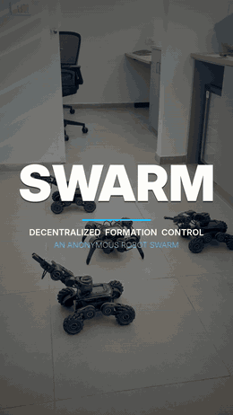
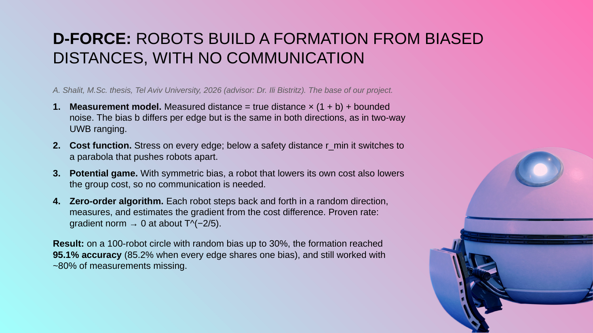
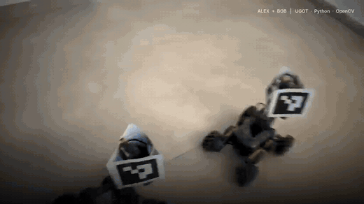
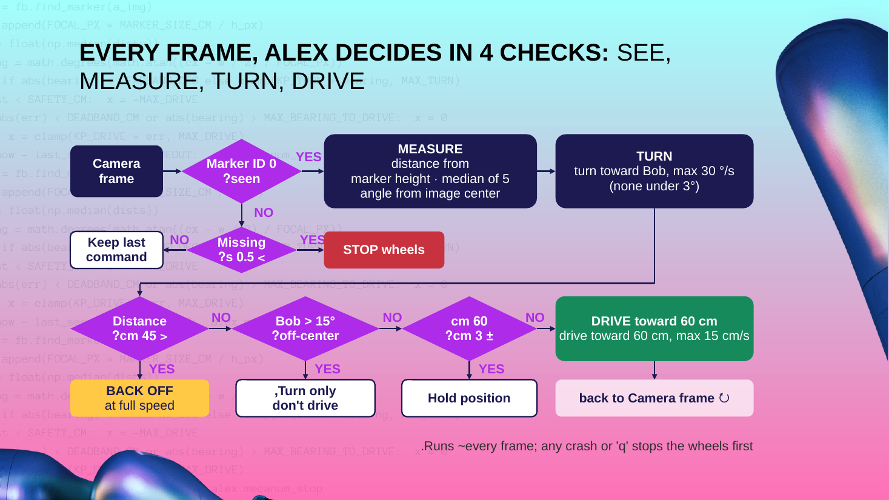
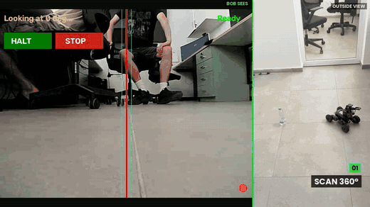
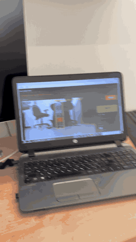

# UGOT Swarm Robotics — Vision-Based Multi-Robot Control

<p align="center">
  
</p>

Final-year project (Industrial Engineering & Management, Tel Aviv University): building toward
**decentralized, ID-free formation control** for a swarm of UGOT mecanum robots, based on the
D-FORCE distributed formation-control model.

This repository holds the hands-on building blocks so far: camera perception, distance and
bearing estimation from a single camera, and closed-loop control of real robots, all in Python.

## Background: D-FORCE

Robots build a formation from biased distance measurements, with no communication between them
(A. Shalit, M.Sc. thesis, Tel Aviv University, 2026; advisor Dr. Ilai Bistritz). Our goal is to run
it on real UGOT robots, using what each robot's own camera sees.

<p align="center"></p>

## In action

### Leader-follower with ArUco markers (`follow_bob.py`, `chase_bob.py`)

Every robot carries the same marker (ID 0), so the swarm stays anonymous. Alex finds Bob's marker,
estimates distance and bearing from it, and keeps 60 cm behind him. No messages pass between them.

<p align="center"></p>

Each frame, Alex decides in four checks: see, measure, turn, drive.

<p align="center"></p>

### Bottle hunter (`bottle_hunter.py`, `bottle_detect.py`)

Bob scans 360° in 30° steps, finds a bottle with YOLOv8, centers it, auto-calibrates distance,
and drives a square of four viewpoints around it.

<p align="center"></p>

### Orbit (`bottle_orbit.py`)

Search → align → approach to 60 cm → orbit in an arc while keeping the bottle centered,
with a live web dashboard.

<p align="center"></p>

## What's here

| Module | What it does |
|---|---|
| `bottle_detect.py` | YOLOv8 object detection on the robot's live camera, with a web dashboard, LED/voice state signals and MP4 recording |
| `bottle_hunter.py` | 360° scan, centering, focal-length auto-calibration and a 4-viewpoint "square" around a target |
| `bottle_orbit.py` | State machine (search → align → approach → orbit): drives to 60 cm and moves in an arc around the target while keeping it centered, with IMU-checked heading and watchdog safety stops |
| `equidistant.py` + `geometry.py` | Localizes two objects from one camera view, computes the point on the robot's axis that is equidistant from both, drives there and measures the error |
| `aruco_check.py` | ArUco-marker distance and bearing (pinhole model), with focal calibration |
| `track_rotate.py` | Robot rotates in place to keep another robot's marker centered |
| `follow_bob.py` | Leader-follower: one robot follows another at a fixed distance (P-control on bearing and distance, median filtering, safety distance) |
| `chase_bob.py` | Two robots live: drive the leader with the keyboard, the follower tracks it automatically |
| `test_geometry.py` | 25 unit tests for the geometry, including a synthetic camera round trip |

## Results

Equidistant-point experiment (`equidistant_results.csv`), two real runs:

| Run | Distance driven | Final distances to the two objects | Error |
|---|---|---|---|
| 1 | 55 cm | 125.8 / 122.1 cm | 3.0 % |
| 2 | 104 cm | 102.2 / 105.1 cm | 2.8 % |

## Tech

Python · OpenCV (ArUco) · Ultralytics YOLOv8 · NumPy · pytest · UGOT Python SDK ·
a small built-in HTTP server for the live dashboards (MJPEG streaming)

## Running

```bash
pip install -r requirements.txt
py -3.11 -m pytest test_geometry.py -v          # geometry tests, no robot needed
py -3.11 equidistant.py --dry-run               # full flow, wheels never move
```

The robot scripts need UGOT robots on the same network (IPs are set at the top of each file).
YOLO weights (`yolov8s.pt`) are downloaded automatically by Ultralytics on the first run.

## Safety

Nothing moves before START; the STOP button, Ctrl+C or any crash stops the wheels first;
a watchdog stops the robot if motion commands stop arriving.
